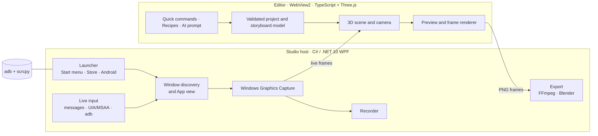

<div align="center">

# ▶ LaunchReel Studio

**Make launch films, ads and screenshots from your real, running app, not a lookalike.**

Open any Windows or Android app and stage its real UI in 3D. Direct the shots by hand, with quick commands or with any AI chat, then export 1080p or 4K video at 30 or 60 fps. Everything runs locally on your PC.

[](LICENSE)


</div>

---

## Why LaunchReel

Product videos usually show a mock-up: a redrawn UI, invented data, a feature that doesn't quite exist yet. LaunchReel only works with what your app actually does:

- **Real pixels.** It captures your app's own window, live, through Windows Graphics Capture.
- **Real behaviour.** Every click in App view or Live 3D goes to the real app, and demos are performed by the real app while Studio records.
- **Real control.** No cloud, no account and no API key. AI direction works by copy and paste, and AI replies are validated *data*, never code.

## Features

### Capture any app
| | |
|---|---|
| **Desktop apps** (Win32, WPF, WinForms, Electron, Qt…) | Pick from your Start menu, browse for an `.exe` or shortcut, or choose any open window. |
| **Store and packaged apps** (UWP, WinUI 3, MSIX) | Launched the way their Start tile launches them, and recognised by app ID, even inside `ApplicationFrameHost`. |
| **Android apps** on a phone (USB or Wi-Fi debugging) or the Android Emulator | Studio lists devices and their apps, starts the app like a tap on its icon, and shows it through a borderless [scrcpy](https://github.com/Genymobile/scrcpy) live mirror. |
| **Whole screen** | Includes pop-ups, menus and previews that a window capture can't see. Afterwards, frame just your app with ✂ **Frame**. |

- **App view** places the app's own window inside Studio. Every button, menu and dialog belongs to the app.
- **Live 3D** lets you click, type and scroll on the 3D picture itself. The app's window, your cursor and keyboard focus never move.
  - Win32 apps receive window messages.
  - WPF, WinUI and UWP apps are driven through their accessibility actions.
  - Android apps receive `adb` input (taps, swipes, typing, Back, Home).
- **Recording** at 30 or 60 fps runs on a wall-clock schedule, so a 10-second take is 10 seconds long.
- **Never intrusive.**
  - A running app is never started a second time.
  - Studio never shows a window the app has hidden.
  - Closing Studio hands the app back exactly where and how it was.

### Stage it in 3D
- **Frames:**
  - monitor, laptop, tablet, phone;
  - a floating screen;
  - a **glass panel** (just your app as a lit glass slab);
  - **just the app**;
  - a **title card**.
- **Stages:** studio cyclorama, PC desk, desk, gradient, abstract, void, **Aurora**, **Atelier**, **Pastel**.
- **Camera moves:**
  - Hero (the app fills the frame), reveal, push, orbit, dolly, tilt, close-up, swoop, rise, still;
  - four easings;
  - your own keyframes, set by dragging the preview.
- **The launch-film look:**
  - **Depth of field.** The world blurs like a fast lens, with drifting bokeh lights, while the app stays sharp.
  - **Clean glass tint** removes the wallpaper colour that shows through acrylic or mica apps.
  - A lit glass rim and a soft vignette.
- **Words:** a headline and eyebrow with placement, size, colour and motion (rise, pop, fade). Titles step aside during zooms.

### Every part of your app is editable
In *Pick sections, callouts and focus…*:
- **Sections:** drag over a region (sidebar, cards, search bar) and it lifts off the screen in 3D, cut from the app's own pixels. Its motion can be pop, float, slide or hold.
- **Callouts, Spotlight, Outline** and **Zoom**, where the camera flies into one control. Zooms never magnify past the footage's own resolution, so close-ups stay crisp.
- **Edge-snapped cutouts:**
  - frames and sections snap to the app's real window borders, with Windows 11 corner radii, so no desktop shows at the edges;
  - hold **Alt** to place them freely.

### Direct it three ways
1. **Recipes.** One click turns your captures into a complete film, cut to a 120 BPM beat grid: launch film, promo short or feature tour.
2. **Quick commands** (local, no AI):
   ```text
   laptop on workspace, hero camera, explode, title "Copy once. Paste anywhere."
   shot 2 phone, orbit, neon
   all shots fade · portrait 60fps · bokeh · clean tint
   ```
3. **Your AI chat:**
   - Describe the film and press *Copy prompt*.
   - Paste the prompt into any assistant, then paste its reply back.
   - Press *Review* and apply.
   - When your app is connected, the prompt lists its **real controls**, so the AI can script a **demo**: clicks, typing, keys, scrolls and waits that your real app performs while Studio records.
   - Demos stop on any mouse movement or Esc, never click outside your app, and can't close, quit or switch apps.

### Export
- **Studio render** matches the preview frame for frame:
  - 1080p or 4K;
  - landscape, portrait or square;
  - 30 or 60 fps;
  - H.264 with your soundtrack.
- **Cinematic render** uses Blender Cycles: path-traced lighting, real depth of field and motion blur.
- **Original soundtracks** come from a local synthesizer, at 120 BPM so cuts land on the beat. No samples and no licences.
- **Screenshots** of any frame are available at full output size.

### Simple by default
The inspector opens in **Simple** mode, showing only stage, frame, words, camera move, sections and format. Switch to **Advanced** to see pose, lighting, finish, easing, lens, keyframes, layer maths, media offsets and the rest. The choice is remembered.

## Compatibility

| App type | Launch from Studio | App view (hosted) | Live 3D input | Notes |
|---|:-:|:-:|:-:|---|
| Win32 / WinForms / Electron / Qt | ✅ | ✅ | ✅ full (click, drag, right-click, wheel, keys) | Posted window messages |
| WPF | ✅ | ✅ | ✅ click, select, toggle, expand, type, scroll | No drag or right-click |
| WinUI 3 / UWP / packaged (MSIX) | ✅ via Start menu list | ✅ | ✅ like WPF | Matched by app ID |
| Android phone (USB or Wi-Fi) | ✅ | ✅ (scrcpy mirror) | ✅ tap, swipe, scroll, type, Back, Home | Needs adb and scrcpy |
| Android Emulator | ✅ (and boots AVDs) | ✅ | ✅ with scrcpy | Without scrcpy, choose the emulator's own window (best-effort input) |
| Apps running as administrator | ⚠ start them yourself | ❌ | ❌ | Windows blocks input from a normal-rights app |
| Games or exclusive full-screen apps | ⚠ window capture only | ❌ | ❌ | Use *Whole screen* |

## Requirements

- **Windows 11** (recommended) or Windows 10 version 2004 or later, with the [WebView2 runtime](https://developer.microsoft.com/microsoft-edge/webview2/) (built into Windows 11).
- **[.NET 10 SDK](https://dotnet.microsoft.com/download)** and **[Node.js 20+](https://nodejs.org/)** to build.
- **[FFmpeg](https://ffmpeg.org/)** on `PATH`, for recording and export: `winget install Gyan.FFmpeg`.
- Optional:
  - **[Blender 4.x](https://www.blender.org/)** for cinematic renders (choose it in Settings).
  - **Python 3** with `numpy` and `scipy` for soundtrack generation.
  - **Android:** `adb` (from Android Studio, or bundled with scrcpy) and **scrcpy** for the live mirror: `winget install --id Genymobile.scrcpy`.

## Quick start

```powershell
git clone https://github.com/shdra06/launchreel-studio.git
cd launchreel-studio
npm ci
.\Start Studio.cmd
```

`Start Studio.cmd` builds only when the sources changed (type check, tests, web bundle and desktop app), then opens `artifacts\studio\LaunchReel Studio.exe`. To build without opening it, run `npm run build`.

### Your first film in five minutes
1. **Capture** → **Launch an app…** Pick your app from the list and use it in App view.
2. Press **● Record**, show the feature you want to sell, then press **Finish**. Or press **Take still**.
3. **Direct** → choose a **recipe**, such as *Launch film*. A complete, beat-timed story appears in the timeline.
4. Optionally use **Pick sections…** to lift parts of your UI in 3D, or add a zoom on the button that matters.
5. Press **Export film** and choose Studio render.

### Android setup
1. On the phone, turn on **Developer options → USB debugging**, connect it, and accept *Allow USB debugging*. Wi-Fi debugging pairs with `adb pair`.
2. Install scrcpy: `winget install --id Genymobile.scrcpy`. It includes adb, and Android Studio's adb is found automatically.
3. In Studio, go to **Capture** → **Android app…**, pick the device and then the app. No device? Studio lists your Android Studio emulators and can start one.

Studio never installs, removes or changes anything on the device.

## Render from a plan file (automation and AI)

Films can be generated entirely from a JSON plan. That's how the example launch film in [`examples/flyshelf-launch-film`](examples/flyshelf-launch-film) is made:

```powershell
"artifacts\studio\LaunchReel Studio.exe" --data-root "%TEMP%\reel-1" --render plan.json
```

```jsonc
{
  "output": "launch-film.mp4",
  "stills": [1.5, 6],                 // optional: render review PNGs instead of the video
  "project": {
    "name": "My launch film", "width": 1920, "height": 1080, "fps": 30, "audioId": "music",
    "assets": [
      { "id": "demo",  "name": "Demo take",  "source": "clips/demo.mp4" },
      { "id": "music", "name": "Soundtrack", "source": "soundtrack.wav" }
    ]
  },
  "storyboard": { "version": 1, "shots": [
    { "name": "Open", "device": "title", "duration": 2, "title": "Copied something\nyou need again?" },
    { "name": "Reveal", "device": "panel", "duration": 4, "assetId": "demo", "motion": "swoop",
      "stage": "aurora", "depthOfField": 0.75, "title": "One shortcut away.",
      "highlights": [{ "rect": [0.6, 0.15, 0.33, 0.11], "start": 1, "end": 3, "style": "zoom" }] }
  ]}
}
```

The plan is imported, validated and rendered by the same engine as Export. Each render needs its own `--data-root`, because Studio runs once per data folder.

Soundtrack: `python renderers\soundtrack.py out.wav --bars 16 --drops 1,7 --breaks 6 --ending 14 --key D`

## How it works



- **Host** (`src/Studio.Host`):
  - launching and finding windows (`AppCatalog`, `AppWindows`, `Android`);
  - hosting without parenting (`NativeAppSurface`, which never attaches input queues, so apps with global hooks can't freeze the PC);
  - capture, recording, live input, demos and export.
- **Editor** (`web/`): the scene (`scene.ts`), the validated data model shared by the UI, AI scripts, commands and renderer (`project.ts`), commands, recipes and cutout snapping.
- **Renderers** (`renderers/`): the Blender Cycles scene builder and the soundtrack synthesizer.
- **SDK** (`sdk/Studio.Bridge.Wpf`): an optional development bridge that lets a WPF app expose named live elements to Studio.

## Principles

- Real app logic owns behaviour. Studio never fabricates feature outcomes.
- Captured media is immutable. Projects copy assets and store edits separately.
- AI storyboards contain data and asset references only, and are validated before anything changes.
- Your app is never terminated, never launched twice and always handed back where it was.
- Personal data in your app is never cleared, replaced or seeded for a demo.
- Everything is local: no telemetry, no uploads.

## Development

```powershell
npm ci
npm run check          # TypeScript
npm test               # editor tests (node:test)
dotnet test tests\Studio.Host.Tests
npm run build          # full build to artifacts\studio
.\scripts\verify.ps1   # everything, plus two desktop checks against a neutral test window (-SkipDesktop to skip)
```

```
src/Studio.Host/      WPF host: launching, capture, input, export
web/                  editor: Three.js scene, data model, UI
renderers/            Blender renderer, soundtrack synthesizer
sdk/                  optional WPF live-element bridge
tests/                editor tests, host tests, test fixture app
examples/             plan-file films
docs/                 design notes
```

## Known limitations

- **WPF, WinUI and UWP in Live 3D:** no drag and no right-click (their accessibility actions have no equivalent). Use App view for those.
- **Cinematic (Blender) render:** doesn't draw callouts, spotlights, zooms, fades or Clean glass tint yet. Export says so before it starts.
- **Elevated apps:** apps running as administrator can't be hosted or operated. Windows blocks it by design.
- **Android support is new in 0.3.** It has unit tests but has not yet been tried across many devices. Please report what you find.
- **Tight close-ups:** these are limited by the recording's resolution. Record on a high-DPI display for sharper macro shots.

## Contributing

Issues and pull requests are welcome. See [CONTRIBUTING.md](CONTRIBUTING.md).

## License

[MIT](LICENSE). LaunchReel Studio uses [Three.js](https://threejs.org/) (MIT) and [WebView2](https://developer.microsoft.com/microsoft-edge/webview2/). It also calls [FFmpeg](https://ffmpeg.org/), [Blender](https://www.blender.org/) and [scrcpy](https://github.com/Genymobile/scrcpy) as separate programs when they are installed; none of them is bundled.

<sub>Originally built to make the launch film for <a href="https://github.com/shdra06/FlyShelf">FlyShelf</a>, a cross-device clipboard.</sub>
